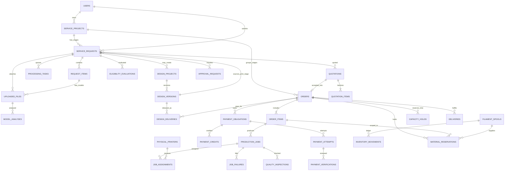

# Database design — logical PostgreSQL schema

## Implemented M05 schema

Head is `0004_design_intake`, extending 0003/0002/0001 unchanged. Only four tables
are added: design_projects/scopes/versions/reviews. Design files reuse uploaded_files
with explicit purpose, verified customer/uploader and nullable print item. A direct
request/customer FK and purpose/item check protect associations. Derived requests
have an immutable exact source-design-version FK, composite project/customer
lineage and unique source/project-stage. SQL guards freeze proof/review/scope
history and validate publication/source relationships. See
[ADR 0005](adr/0005-design-intake-and-lineage.md). No design_deliveries, quotations,
orders or payment tables are created. The broader schema below remains planned.

**Status:** design contract, not an applied migration. Codex must audit actual existing tables before implementing; do not drop tables or user data. Use SQLAlchemy 2 async, Alembic migrations, PostgreSQL constraints and indexes.

## Implemented M04 schema

The single applied chain is `0001_auth_foundation -> 0002_business_foundation ->
0003_printing_intake`. M04 adds only `request_items`, `uploaded_files` and
`processing_tasks`, plus fulfillment and frozen submission fields on existing
requests. Existing authentication/business rows and original hashes survive the
upgrade. [ADR 0004](adr/0004-private-printing-intake.md) specifies composite FKs,
quota reservations, revision hashes and immutable provenance. Material/color/
quality keys are labeled development choices, not FK claims about future stock
or printer profiles. The broader logical schema below remains a design target.

## Conventions
- `id` internal primary key (prefer UUID for externally referenced entities, or bigint with opaque public ID; choose consistently during M00).
- `created_at`, `updated_at`: timezone-aware UTC. Add `version` integer to mutable workflow records for optimistic concurrency.
- Foreign keys explicit `ON DELETE` behavior: RESTRICT for historical transactions; cascade only for truly owned ephemeral children/drafts. Never cascade delete paid orders/quotes/payments.
- Currency is **per quoted stage/payment obligation**, not globally fixed to MMK. Physical printing may use `MMK` under approved physical-goods payment flow; digital-only design sold inside Telegram requires `XTR` (integral Telegram Stars). Use PostgreSQL `NUMERIC`/integer units with proper currency-specific constraints and Python `Decimal` as appropriate; never sum unlike currencies. See `docs/PAYMENTS_COMPLIANCE.md`.
- Status values controlled by enums/check constraints and a domain transition service.
- Unique idempotency keys scoped by actor/action/entity; audit ledger append-only. Add indexes on foreign keys, status+timestamp queues and active reservations.
- Personal data minimization: no plain card secrets; encrypted backups; private attachment references; privacy/retention policy.

## Core entities and relationships
### Identity
- `users`: id, telegram_id (unique bigint), display_name, username nullable, role (`customer`|`owner`), active, created_at, last_seen_at.
- `sessions`: id (random identifier hashed at rest), user_id, expires_at, revoked_at, created_at, last_used_at, metadata minimal. No raw tokens in logs.
- `addresses`: id, user_id, contact_name, phone, city/township, address_line, notes.
- `audit_logs`: id, actor_user_id nullable (system events), action, entity_type, entity_id, old/new metadata (sanitized), reason, correlation_id, created_at.

### Requests, models and analysis
- `service_projects`: id, customer_id, kind (`printing`|`custom_design`|`design_and_print`), status, created_at. Groups stages without treating their payments as one mixed-currency amount.
- `service_requests`: id, service_project_id **required for new records**, customer_id, **stage_kind (`design`|`printing`)**, `source_design_version_id` nullable FK to approved `design_versions` **for derived print requests**, status, revision, canonical_spec_sha256, customer_notes, delivery_choice, submitted_at. Enforce idempotent/unique derived print-stage creation per project + approved design version. The parent `service_projects.kind` records the customer-facing service selection (`printing`|`custom_design`|`design_and_print`). A combined project has a design-stage request followed by a linked printing-stage request; use separately versioned requests, not one mutable cross-stage request.
- `request_items`: id, request_id, description, quantity, material_variant_id nullable, color, quality_profile_id nullable, required_dimensions, special_requirement_text, normalized_spec_json (validated), revision.
- `uploaded_files`: id, owner_id, request_id nullable, request_item_id nullable, request_revision nullable, role (`model`|`reference`|`proof`|`receipt`), original_name, extension, mime_detected, size_bytes, sha256, storage_key, validation_status, created_at. Do not use client path directly.
- `model_analyses`: id, uploaded_file_id, file_sha256, analyzer_version, dims_mm, volume_cm3 nullable, watertight, warnings, status, created_at.
- `printer_models`: id, manufacturer, model, build_x/y/z_mm, capabilities, active.
- `slicer_profiles`: id, printer_model_id, material_variant_id nullable, quality_id, slicer_name, slicer_version, profile_version, checksum, settings_ref, approved_for_estimates, calibrated_for_live, active.
- `slicing_runs`: id, request_item_id, request_revision, model_analysis_id, slicer_profile_id, orientation_id nullable, filament_g, print_seconds, support_g nullable, warnings, raw_report_key nullable, result_status, created_at; exact version/provenance required.

### Design services
- `design_projects`: id, request_id, customer_id, scope, revision_policy, status, approved_version_id nullable, deadline nullable.
- `design_versions`: id, design_project_id, version, model_file_id nullable, preview_file_id nullable, release_notes, created_at, UNIQUE(design_project_id, version).
- `design_reviews`: id, design_version_id, customer_id, status (`pending`|`approved`|`changes_requested`), customer_feedback, timestamp; approval exact version.
- `design_deliveries`: id, design_stage_order_id, approved_design_version_id, released_file_ids or normalized join table, released_by_owner_id, released_at, customer_access_status; audit releases/downloads. Required for standalone digitally delivered design and for combined-stage contracts explicitly including downloadable files; do not invent file-transfer entitlement for combined print-only deliverables. Never represent a digital design as a physical `deliveries` shipment.
- Convert approved design into a linked print request, not a hidden mutation of already-paid design stage.

### Pricing, eligibility, quotation
- `pricing_policies`: id, version, material pricing policy, machine rates, labor rates, risk, gross_margin, rounding, minimum_price, effective_at, active.
- `auto_quote_policies`: id, version, standard eligibility limits/rules JSON/schema, enabled, calibrated_required, effective_at.
- `eligibility_evaluations`: id, request_id, request_revision, policy_id, result (`pass`|`review`|`error`), reasons, evaluated_at, slicer_run_id nullable.
- `eligibility_flags`: id, evaluation_id, rule_code, severity, description.
- `quotations`: id, request_id, **request_revision, canonical_spec_sha256**, version, stage (`design`|`printing`, must match request `stage_kind`), **mode (`simulation_offer`|`binding_offer`)**, status (simulation uses `test_issued`/`test_accepted`; live uses `issued`/`accepted`), approval_method (`automatic`|`owner`), eligibility_evaluation_id nullable (manual design quotes do not require a slicer evaluation), owner_approver_id nullable, pricing_policy_id, expires_at, currency_code, payment_category, subtotal, discount, total, spec_snapshot_json, issued_at, UNIQUE(request_id, stage, version). **Every binding offer, manual or automated, requires `BINDING_QUOTES_ENABLED` and applicable live/category gates; no in-place promotion of simulation offers.**
- `test_estimates`: id, request_id, request_revision, optional slicing_run_id, estimated_total, display_currency, caveats, pricing_policy_version, created_at; **never payable, accepted or converted directly into a live quote/order**. Simulated end-to-end acceptance uses explicit `simulation_offer` quotations.
- `quotation_items`: id, quotation_id, request_item_id nullable, description, quantity, unit_price, material_cost, machine_cost, labor_cost, overhead_cost, risk_cost, total, cost_snapshot_json.
- `approval_requests`: id, request_id, request_revision, **spec_snapshot_sha256**, quotation_id nullable (exact quote/version when one exists), status, reason, owner_id nullable, decided_at, customer_message nullable, internal_notes nullable. Decisions must be invalidated when request/model/specification provenance changes.
- `approval_history`: id, approval_request_id, previous_status, new_status, actor_user_id, reason, created_at.

### Orders, payments and refunds
- `orders`: id, service_project_id, customer_id, accepted_quotation_id (unique), **stage (`design`|`printing`), mode (`simulation`|`live`), payment_category (`physical_goods`|`digital_goods`)**, status (including `on_hold`, `refund_pending`, `refunded`), currency_code, total_amount, accepted_spec_snapshot_json, accepted_at, confirmed_at nullable, created_at. One accepted stage quote creates one stage order; **design+print uses two stage orders** linked by `service_project_id`. Enforce **at most one active payable order per project+stage** unless an audited replacement/refund transaction explicitly permits a new obligation; unique `accepted_quotation_id` by itself is insufficient.
- `order_items`: id, order_id, **request_item_id nullable**, `item_kind` (`print_item`|`design_service`), description, quantity, unit_price_snapshot, total_price_snapshot, spec_snapshot_json. A design service is a genuine paid line item without a print `request_item`/STL.
- `payment_obligations`: id, order_id, stage, amount_due, currency_code, **payment_category (`physical_goods`|`digital_goods`), mode (`simulation`|`live`)**, due_at, status; each obligation is single-currency and stage-specific. **Use a unique obligation per stage order** in MVP (`UNIQUE(order_id)`), with adjustment/refund events rather than duplicate payable obligations. The linked order and quotation must have matching stage/currency/mode/category; enforce atomically in domain commands with integrity-focused tests.
- `payment_attempts`: id, obligation_id, method, provider nullable, provider_charge_id nullable, amount_submitted, currency_code, customer_reference nullable, status, submitted_at; inherit immutable `mode`, `stage` and `payment_category` through the referenced obligation; unique provider charge ID per provider where present; simulated payments must not satisfy live obligations. Do not accept receipt uploads as evidence for a Telegram Stars checkout.
- `payment_receipts`: id, payment_attempt_id, uploaded_file_id.
- `payment_verifications`: id, payment_attempt_id, verified_by_owner_id, result, bank_reference nullable, reason, verified_at; one accepted verification per attempt, enforce idempotency.
- `payment_credits`: id, obligation_id, payment_attempt_id, provider, **normalized external_transaction_key**, amount, currency_code, verified_provider_event_id nullable, owner_release_verification_id nullable, recorded_at; **immutable financial credits** with unique provider+account/merchant+transaction key, preventing one real transfer/charge from paying multiple stage orders. Credits/reversals/refunds reconcile to obligation; disputed/overpayments remain visible. Validate actual transaction uniqueness and scope with the chosen provider before live activation.
- `refunds`: id, obligation_id, amount, reason, status, approved_by, processed_at, external_reference; immutable financial event history.
- **Architecture decision:** design+print has one `service_projects` parent, one design-stage order/quote/obligation and one printing-stage order/quote/obligation after customer design approval. Do not merge the stage prices/currencies or permit one stage's payment to authorize the other.

### Filament inventory
- `materials`: id, type_name (PLA/PETG/etc), specs.
- `material_variants`: id, material_id, brand, color, diameter_mm, grade, active.
- `suppliers`: id, name, contact.
- `filament_spools`: id, variant_id, supplier_id nullable, purchased_grams, tare_grams nullable, cost_total, purchased_at, state, location.
- `inventory_movements`: id, spool_id, kind (`opening_stock`|`purchase`|`consume`|`waste`|`adjustment`|`return`), **signed** delta_grams, reference_type/id, actor, created_at; immutable append-only ledger. Consumption/waste decreases stock; no double-counting spool `purchased_grams` and initial ledger credit. Prefer no duplicated writable on-hand counter.
- `material_reservations`: id, order_id, **order_item_id**, spool_id, grams, remaining_grams, status (`held`|`firm`|`released`|`consumed`|`expired`), expires_at, created_at. `held` is provisional and expires; `firm` is payment-verified/printing-stage stock awaiting production, not silently expired. Reserve in a lock-protected transaction; renew/release explicitly. A design-stage order never reserves printing filament.
- `material_consumptions`: id, production_job_id, spool_id, grams, wasted_grams, recorded_at; movements posted transactionally with consumption. **Avoid a second independent decrement**: consumption row and movement must refer to the same physical usage event.
- `capacity_holds`: id, order_id, printer_model_id or capability_pool_id, window_start, window_end, estimated_seconds, status (`held`|`confirmed`|`released`|`expired`|`invalidated`), expires_at, created_at; conservatively reserve printer-class time/capacity before live checkout without assigning a specific machine. Lock/revalidate availability, and promote/release independently of later owner-approved physical assignment.
- `purchase_orders`: id, supplier_id, status, totals, purchased_at, received_at; optional for MVP, but schema should allow future procurement.

### Printer assets, production, QC and fulfillment
- `physical_printers`: id, printer_model_id, display_name, serial_number nullable unique, status, nozzle_mm, installed_at, active; none required in development mode.
- `printer_material_compatibility`: id, printer_model_id or physical_printer_id (choose explicit scope), material_variant_id, approved, constraints; UNIQUE pair.
- `printer_cost_profiles`: id, printer_model_id, hourly_rate, effective_from, version, calibrated.
- `production_jobs`: id, order_item_id, quantity, **attempt_number**, **reprint_of_job_id nullable** (self FK), units_completed, units_qc_passed, status, simulation, planned_profile_id, started_at nullable, completed_at nullable; many attempts/jobs per order item. Enforce ordered-vs-QC-passed quantity reconciliation, including partial passes and reprints.
- `job_assignments`: id, production_job_id, physical_printer_id nullable, **slicer_profile_id** (FK to the approved virtual/calibrated `slicer_profiles` registry), **planned_start_at, planned_end_at**, recommendation_reason, assigned_by_owner_id nullable, status, approved_at, created_at. Preserve all reassignment history; in simulation `physical_printer_id` is NULL, in live operation a real printer is mandatory. **Enforce non-overlapping active/approved physical-printer time windows** (e.g. PostgreSQL range/exclusion constraint with appropriate extension, or explicitly serialized locking + conflict tests).
- `job_status_history`: id, job_id, old_status, new_status, actor, reason, created_at.
- `job_failures`: id, job_id, reason_code, narrative, units_completed, wasted_g, downtime_minutes, attachment_ids, recorded_at, owner_decision/status, decided_at nullable.
- `quality_inspections`: id, job_id, result, inspector_id (owner), notes, inspected_at.
- `deliveries`: id, order_id, method (`pickup`|`delivery`), address_id nullable, status, tracking nullable, handed_over_at nullable.
- `notification_outbox`: id, event_key UNIQUE, recipient_user_id, event_type, payload_minimized, status, attempts, next_attempt_at, delivered_at.
- `processing_tasks`: id, request_id, uploaded_file_id, kind, state (`pending`|`leased`|`succeeded`|`failed`), attempt_count, lease_expires_at, max_attempts, idempotency_key, created_at, completed_at; M04 can enqueue without claiming M06 worker is running.

## High-level relationships

## Constraints and concurrency
- **Migration timing:** `service_requests` is introduced in M03 without the `source_design_version_id` FK, which is added via Alembic during M05 once `design_versions` exists. Target schema below describes the completed relationship; do not reference a table that does not yet exist.
- Cross-stage lineage: parent project represents the selected service; each request represents a single `stage_kind`. Create the printing-stage request for design+print only from an explicitly approved design version, with FK and uniqueness/idempotency protection. Never allow design payment to satisfy a printing obligation. A design request can initially have **zero print request_items** (its brief lives in the design project); quote/order `design_service` lines do **not** require fake STL items. A submitted printing request must have at least one valid item, validated in the domain service.
- `UNIQUE(users.telegram_id)`, `UNIQUE(quotations.request_id, stage, version)`, `UNIQUE(design_versions.design_project_id, version)`, `UNIQUE(notification_outbox.event_key)`, immutable unique `payment_credits` provider transaction identity, one active stage order guard, unique accepted quote/order mapping. A partial unique index may be needed for active stage obligations, alongside transaction locks.
- `CHECK` quantities >0, consumption/reservation grams >=0, **inventory ledger deltas signed by movement kind**, nonnegative price/amount, integral XTR units, stage/quotation/order mode consistency, valid enum states and required columns. Cross-table transition rules belong to transactional domain services.
- Add indexes on customer+created_at, request status+created_at, quote expiry, payment verification pending, assignment queue, inventory active reservations, outbox retry due.
- `SELECT ... FOR UPDATE` for spool reservation, payment verification, quote acceptance and simultaneous job assignment; retry on serialization conflicts as needed.
- Concurrent stock **and printer-capacity** reservations must be tested with simultaneous printing orders for the last usable grams/available time window. Derive on-hand from spool ledger movements exactly once; subtract active reservations; prevent negative availability in a single DB transaction. Include race between quote acceptance, expiring holds, checkout, provider callbacks and subsequent reservation promotion. Only physical-print stages need filament reservations.
- No direct public record deletion for issued quotes, payment ledger, stock ledger or audit logs; use cancellation/reversal events and retention policy.
